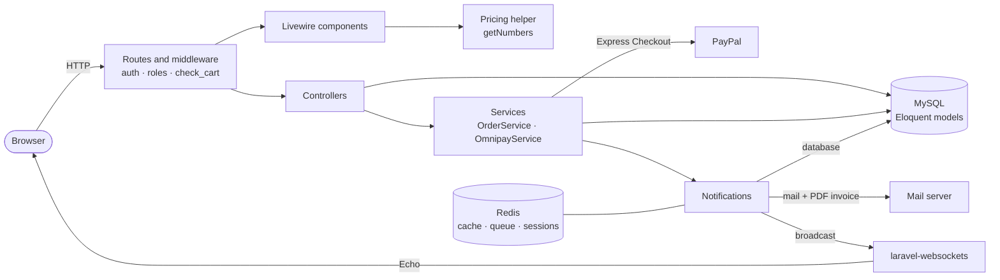
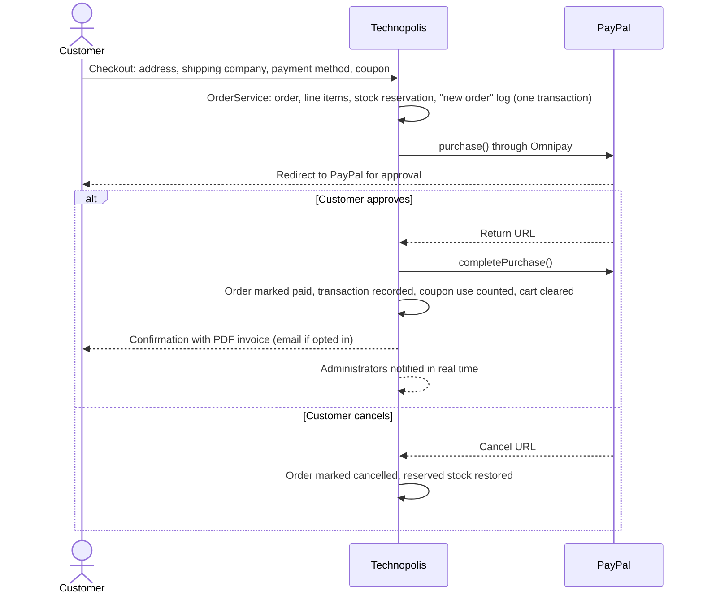
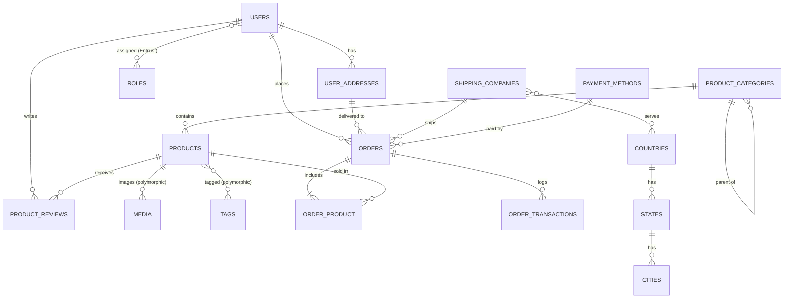

<div align="center">

# Technopolis

**An end-to-end e-commerce web application built with Laravel 8 and Livewire**

Graduation project · Department of Computer Science and Information Technology · Al-Aqsa University, Gaza<br>
Graded **95/100** and selected by the department as the **Best Technical Graduation Project** of its cohort (2023)


</div>

---

## Overview

Technopolis brings three applications together in one Laravel codebase:

- a **storefront** where customers browse, search, filter and buy;
- a **customer account area** for profiles, address books, orders and notifications;
- an **administration panel** for catalogue, orders, customers, logistics and staff.

Orders are paid through **PayPal Express Checkout**. Each paid order produces a **PDF invoice**, sent to the customer by email, and a **real-time notification** for administrators over WebSockets.

The official title of the graduation project is *Ecommerce System for Smart Electronics ("Retailer")*.

> **Status.** This repository is an academic portfolio snapshot, not a production deployment. Laravel 8 reached end of life in January 2023. Section [Security review and known limitations](#security-review-and-known-limitations) lists what was hardened in November 2026 and what a production version would still need.

---

## At a glance

| | |
|---|---|
| **Users and roles** | Admin, supervisor and customer, with role-based route guards (Entrust) |
| **Catalogue** | Nested categories, tags, multi-image products, featured and related products |
| **Commerce** | Session cart, wishlist, coupon codes, 15% tax, country-specific shipping companies |
| **Payments** | PayPal Express Checkout through Omnipay, with return and cancel handling |
| **Documents** | PDF invoices generated with mPDF and attached to the confirmation email |
| **Real time** | Database and broadcast notifications over laravel-websockets (Pusher protocol), consumed by Livewire |
| **Administration** | Earnings and order statistics, monthly revenue chart, full CRUD, a nine-state order lifecycle |
| **Data** | 24 migrations; seeders for demo catalogue, users, coupons, orders and a world dataset (countries, states, cities) |

---

## Code tour: where to look

| Concern | Implementation | Location |
|---|---|---|
| Pricing | Subtotal, coupon discount, tax, shipping and total are computed **server-side** from the session cart | [`app/Helper/GeneralHelper.php`](app/Helper/GeneralHelper.php) (`getNumbers()`) |
| Order creation | One database transaction: order, line items, stock reservation with row locks, and the first transaction-log entry | [`app/Services/OrderService.php`](app/Services/OrderService.php) |
| Payment gateway | Omnipay wrapper for PayPal Express; credentials and sandbox mode come from configuration | [`app/Services/OmnipayService.php`](app/Services/OmnipayService.php) |
| Payment return and cancel | Ownership and state checks, paid status, transaction record, coupon usage, cart clean-up, invoice and notifications | [`app/Http/Controllers/Frontend/PaymentController.php`](app/Http/Controllers/Frontend/PaymentController.php) |
| Access control | Route groups for `admin\|supervisor` and `customer`, plus a role-routing middleware | [`routes/web.php`](routes/web.php), [`app/Http/Middleware/Roles.php`](app/Http/Middleware/Roles.php) |
| Interactive UI | Cart, totals, checkout, shop filtering and sorting, wishlist and notifications as Livewire components | [`app/Http/Livewire`](app/Http/Livewire) |
| Notifications | Queued mail, database and broadcast channels | [`app/Notifications`](app/Notifications) |
| Order lifecycle | Nine named states, from new order to refunded | [`app/Models/Order.php`](app/Models/Order.php) |
| Validation | Form Request classes for every administrative resource and the customer profile | [`app/Http/Requests`](app/Http/Requests) |

---

## Features

### Storefront
- Catalogue browsing by nested category and by tag, product pages with image galleries, a quick-view modal, and related and featured products.
- Sorting by price in either direction, with pagination of 12 products per page.
- Cart and wishlist built as Livewire components that update without page reloads.
- Coupon codes applied at checkout, and 15% tax computed on the discounted subtotal.
- Checkout with a saved address, a shipping company offered for that address's country, and a payment method.

### Customer account
- Registration with email verification.
- Profile with image, and an address book with country → state → city selection.
- Order history with status labels.
- In-app notifications.

### Administration panel
- Dashboard with monthly and annual earnings from finished orders, this month's new and finished order counts, and a monthly revenue chart.
- Real-time alert when a new order is paid.
- Management of:
  - product categories and products (multi-image upload, resized with Intervention Image);
  - tags, coupons and reviews;
  - customers and their addresses, and supervisors;
  - orders, through a nine-state status lifecycle;
  - countries, states and cities, shipping companies and payment methods.
- Search across administrative lists.

### Operations
- Notifications are queued on Redis and delivered through the database and broadcast channels; the order confirmation with the PDF invoice is also emailed to customers who accept emails.
- A scheduled daily command deletes notifications that have already been read.

---

## Architecture



### Checkout and payment flow



### Core data model



### Roles

| Role | Access |
|---|---|
| **Admin** | Full administration panel, including supervisor accounts |
| **Supervisor** | Administration panel, with permissions seeded per role through Entrust |
| **Customer** | Storefront account: profile, addresses, checkout and order history |

---

## Tech stack

| Layer | Technologies |
|---|---|
| Backend | Laravel 8.83, PHP 7.3–8.0, Eloquent ORM, Form Requests, queued notifications |
| Interactive UI | Livewire 2, Alpine.js, Laravel Echo, SweetAlert / livewire-alert |
| Front end | Blade, Bootstrap 4, jQuery, Laravel Mix 6 |
| Payments | Omnipay 3 with the PayPal Express gateway |
| Documents and media | mPDF (`carlos-meneses/laravel-mpdf`), Intervention Image |
| Access control | Entrust roles and permissions (`mindscms/entrust`) |
| Cart | `mindscms/laravelshoppingcart` (session cart and wishlist instances) |
| Real time | `beyondcode/laravel-websockets` (Pusher protocol), `pusher/pusher-php-server` |
| Data and infrastructure | MySQL / MariaDB, Redis (cache, queue, sessions) via Predis |
| Utilities | `cviebrock/eloquent-sluggable`, `nicolaslopezj/searchable` |

---

## Getting started

### Prerequisites
- PHP 8.0, or 7.3–7.4, with the `mbstring`, `gd`, `pdo_mysql`, `xml`, `curl` and `zip` extensions. Laravel 8 predates PHP 8.1, so newer versions may emit deprecation notices.
- Composer 2.
- MySQL 5.7+ or MariaDB 10.4+.
- Redis.
- Node.js 14–16 with npm.

### Installation

```bash
git clone https://github.com/basilfarra/Technopolis.git
cd Technopolis

composer install
cp .env.example .env
php artisan key:generate

# Edit .env: DB_*, REDIS_*, MAIL_* (e.g. Mailtrap) and PAYPAL_* (PayPal sandbox API credentials)
php artisan migrate --seed

npm install && npm run dev
php artisan serve
```

To deliver notifications and real-time alerts, run these in separate terminals:

```bash
php artisan queue:work
php artisan websockets:serve
```

> **Running without Redis or WebSockets.** For a quick local tour, set `CACHE_DRIVER=file`, `SESSION_DRIVER=file`, `QUEUE_CONNECTION=sync` and `BROADCAST_DRIVER=log` in `.env`. The broadcasting configuration expects TLS on port 6001, as in the original deployment.

### Demo accounts (local seed data only)

| Role | Email | Password |
|---|---|---|
| Admin | `admin@ecommerce.test` | `123123123` |
| Supervisor | `supervisor@ecommerce.test` | `123123123` |
| Customer | `customer@ecommerce.test` | `123123123` |

These accounts exist only for local demonstration. Never seed them into a public deployment.

---

## Project structure

```text
app/
├── Helper/             GeneralHelper (pricing), MySlugHelper
├── Http/
│   ├── Controllers/    Backend (admin CRUD) · Frontend (store, customer, payment) · Auth
│   ├── Livewire/       Backend (dashboard, notifications) · Frontend (cart, checkout, shop, wishlist)
│   ├── Middleware/     Roles, CheckCart
│   └── Requests/       Form Request validation
├── Models/             Product, Order, User, UserAddress, ProductCoupon, ...
├── Notifications/      Order created, order thanks (with PDF), admin order alerts
└── Services/           OrderService, OmnipayService
database/
├── data/               World dataset (countries, states, cities)
├── migrations/         24 migrations
└── seeders/            Demo data and roles
resources/views/        frontend · backend · livewire · layouts (incl. invoice) · partial
public/                 frontend (storefront template) · backend (admin template) · assets (images)
routes/web.php          Storefront, customer, checkout and admin routes
```

---

## Testing

Functional and acceptance testing was carried out manually during the graduation project. The repository contains only Laravel's example tests. The next step is automated feature tests for the areas where errors cost most:

- pricing, covering coupons, tax and shipping;
- the payment return and cancel paths;
- role-based access to the administration routes.

---

## Security review and known limitations

A review in November 2026 removed an archived environment file from the repository history and applied these fixes:

- Customer-supplied names and review text are now escaped on output.
- The PayPal return and cancel endpoints check that the order belongs to the signed-in customer and is still unpaid. Checkout accepts only the customer's own delivery address.
- The role middleware caches each user's route separately; previously one global cache key was shared by every user.
- Profile validation checks mobile-number uniqueness on the correct column and no longer accepts SVG uploads.
- Order creation runs in a single database transaction, with row locks on stock updates.
- The world dataset is seeded through the application's database connection, not a shell command with hard-coded credentials. The dataset file moved out of the public web root.
- A failed PayPal completion now returns the customer to the cart with a message; the invoice folder is created when needed.

What a production version would still need:

- **Framework upgrade.** Laravel 8 no longer receives security fixes.
- **Payments.** PayPal Express Checkout (the classic NVP/SOAP API) is a legacy integration. The modern route is PayPal's REST Orders API with verified webhooks. The IPN/webhook endpoint here is an unimplemented stub.
- **Stock.** Stock is reserved when the order is created and released only if the customer cancels at PayPal; abandoned payments keep it reserved. Stock levels are not prevented from going negative.
- **Product descriptions.** These are administrator-authored HTML rendered without sanitisation (for example with HTML Purifier).
- **Database integrity.** Foreign keys on the order tables are not enforced at database level. Some state-changing actions, such as removing a profile image, use `GET` requests.
- **Broadcasting.** The broadcasting client disables TLS certificate verification, which suits a self-signed local certificate only.

---

## Project history and credits

Development began in 2021. The project was completed and assessed as a graduation project in 2023: it was graded 95/100 and selected by the Department of Computer Science and IT at Al-Aqsa University as the Best Technical Graduation Project of its cohort.

The project builds on the work of others, gratefully acknowledged:

- **MindsCMS**: the role-management and shopping-cart packages (forks of Entrust and LaravelShoppingcart) and the countries, states and cities dataset.
- **Boutique** by [Bootstrapious](https://bootstrapious.com): the storefront template, customised for this project.
- **SB Admin 2** by [Start Bootstrap](https://startbootstrap.com/theme/sb-admin-2) (MIT): the administration template.
- **Laravel, Livewire, Omnipay, mPDF, Intervention Image** and the other packages listed in `composer.json`, each under its own licence.

---

## Team and my role

This was a team graduation project. My responsibilities, as recorded in the department's attestation (August 2023), covered:

- conception and planning, and requirements analysis;
- wireframes and UX/UI design;
- software architecture and relational database design;
- front-end and back-end development;
- technical documentation.

---

## Licence

The repository is shared for portfolio and academic review. The Laravel application skeleton is MIT-licensed. The bundled templates and third-party packages remain under their own licences (see [Project history and credits](#project-history-and-credits)).

---

<div align="center">

**Basil S. N. Al-Farra** · [LinkedIn](https://www.linkedin.com/in/basilfarra) · [GitHub](https://github.com/basilfarra)

</div>
